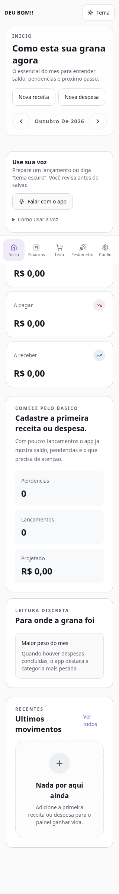
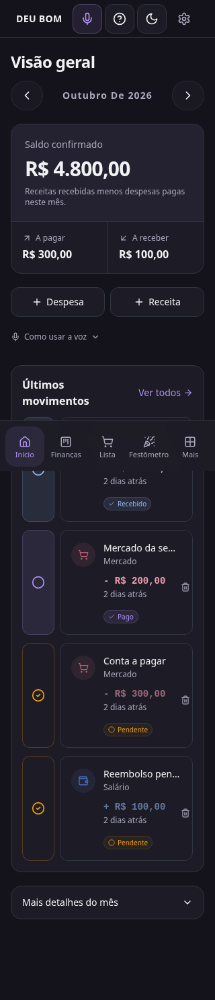

# Deu Bom — Finanças sem erro

Aplicação React/TypeScript + Vite, shadcn/ui, Zustand e Supabase. Este é o repositório da aplicação completa: receitas, despesas, recorrências, workspaces, compras, metas, análises e eventos.

## Desenvolvimento

Use Node 24 e npm. O frontend não exige a CLI do Supabase; a instalação abaixo evita o download opcional dela pelo postinstall e recompõe os módulos nativos usados pelo build, mantendo a verificação de integridade do npm.

```sh
npm ci --ignore-scripts
npm rebuild esbuild @swc/core
cp .env.example .env.local
# Preencha a configuração pública do projeto Supabase correto.
npm run dev -- --host 0.0.0.0
```

O projeto esperado está em `supabase/config.toml`: `ufmzkxhrljpogulllnzv`. Use sua URL e chave **publishable** ou **anon** nas variáveis `VITE_SUPABASE_URL` e `VITE_SUPABASE_PUBLISHABLE_KEY`. Nunca use `service_role` no frontend. As variáveis injetadas pelo ambiente têm prioridade sobre `.env.local`: confira se apontam ao projeto correto antes de executar o app ou gerar um build.

`VITE_PUBLIC_APP_URL` é opcional para fixar um domínio canônico de convites e recuperação de senha. Sem ela, o app usa a origem atual do navegador. Os domínios usados precisam ser permitidos nas configurações de Auth do Supabase.

## Ajustes de interface

- Controle por ícone de sol/lua sempre acessível: Claro, Escuro e Sistema, com escolha persistida e acompanhamento da preferência do dispositivo.
- 24 paletas, incluindo preto, cinza escuro, prata e grafite nos dois modos, inclusive nos modais; categorias já personalizadas pelos usuários são preservadas.
- Receita e despesa com a mesma aparência inicial; destaque somente ao selecionar. Removidos o atalho flutuante de nova despesa, um link repetido de detalhes e o botão Salvar duplicado do formulário.
- Microfone no cabeçalho de todas as telas autenticadas, com reconhecimento único e contexto da aba atual. Diga “despesa mercado 35,90 reais”, “salário 2000 reais”, “tema claro”, “tema escuro” ou “modo do sistema”. Lançamentos abrem o formulário para revisão; nenhuma transcrição é salva automaticamente.
- A escuta aguarda seis segundos de pausa ou o botão Concluir fala. O parser reconhece valores por extenso, datas e repetição, preserva compras/recorrência e distingue valores decimais de parcelas. Resultados parciais não executam comandos, erros de microfone têm orientação e a escuta termina ao sair da tela. A voz depende do suporte e das permissões do navegador, que pode processar o áudio online.
- Aviso único de nova versão pelo service worker e por `version.json`, com verificação ao abrir, voltar ao app e a cada minuto. Permite adiar e pede confirmação antes de atualizar, sem recarregar automaticamente por troca do worker em outra aba.
- O worker guarda apenas assets do app; não mantém respostas autenticadas do Supabase no cache compartilhado.
- Formulário acima da navegação mobile, alvos de toque, foco contido, fechamento por Escape e título/valor dos cartões reorganizados em telas estreitas.
- Falhas de carregamento não simulam saldo zero; falhas de gravação preservam os campos.

## Validação

```sh
npm run typecheck
npm run lint
npm test
npx playwright install chromium
npm run test:e2e -- --workers=3
npm run build
npm run check:supabase
npm run check:vercel
```

Para usar explicitamente o arquivo local no diagnóstico: `npm run check:supabase -- --local`. Em máquinas sem escrita no diretório pessoal, defina `PLAYWRIGHT_BROWSERS_PATH=/workspace/.cache/ms-playwright` ao instalar e executar o navegador.

Os testes de navegador usam exclusivamente uma API simulada (`supabase.test`) em desktop, tablets em retrato/paisagem, Pixel 7 emulado e viewport de 320 px. Cobrem persistência pela API simulada, revisão por voz, temas, atualização, falhas e layouts. Não substituem a validação com contas reais nem o teste acústico em aparelhos físicos. O workflow `Validate app` executa os checks sem publicar em produção.

## Supabase

A configuração pública usada pelo site já publicado foi validada com GET e `limit=0`. As 11 tabelas referenciadas responderam HTTP 200, inclusive `purchase_goals`. Nenhum registro foi solicitado nem alterado. Existência pela API não comprova políticas RLS, constraints, triggers ou RPCs; essa auditoria exige acesso autorizado ao banco.

O ambiente inicialmente injetava uma URL/chave diferentes e recebia HTTP 401. A configuração pública válida foi preparada apenas em `.env.local`, ignorado pelo Git. Corrija os valores do ambiente para o projeto acima; não copie credenciais para commits ou logs.

## Vercel

`vercel.json` fixa a instalação por npm (sem escolher os lockfiles Bun), configura Vite, saída `dist`, fallback SPA e ausência de cache em `/sw.js` e `/version.json`. O endpoint público `https://deu-bom-financas-sem-erro.vercel.app` respondeu HTTP 200 com identificação do Vercel.

O acesso administrativo foi restabelecido com o segredo `VERCEL_TOKEN` e a equipe `team_UChZPctatN15WPf0C0G59snc`. O projeto `prj_s5VpsAYH1MfNwHQwyO1GOJ8N4sX5` está ligado a **alisson-correia/deu-bom** (branch de produção `main`; confirme cada publicação pelo status do deploy). A primeira publicação dos ajustes foi confirmada pelo deploy `dpl_6AA6h5bF64KidCMtHe7v8LZexSxk`, com variáveis públicas do Supabase de produção corrigidas e validação de abertura e temas no domínio público.

Publicações manuais de commits de uma branch não fazem merge na `main`. Antes de futuras publicações automáticas, confira se a `main` contém as melhorias desejadas. Configure credenciais somente nas configurações seguras do ambiente, nunca no Git ou no chat.

## Aparência, ajuda e navegação

- O botão com sol/lua no cabeçalho permite escolher claro/escuro/sistema e 24 cores de destaque em uma lista com amostras. Em Configurações → Aparência, um menu suspenso mostra a cor selecionada e as 24 opções. A escolha independe do modo, fica salva neste navegador e mantém as cores financeiras de status.
- O início prioriza saldo, valores pendentes e últimos movimentos. Os detalhes do mês ficam recolhidos; as ações de receita/despesa são compactas.
- O microfone no cabeçalho usa o contexto da tela. Na lista de compras, prepara um item; nas demais áreas, prepara um lançamento financeiro ou altera o tema. Sempre revise antes de confirmar. O navegador precisa suportar reconhecimento de voz e ter permissão para microfone.
- A interrogação (?) abre um tutorial específico de cada página, com Voltar/Próximo/Concluir. Não altera dados e pode ser reaberto.
- Celulares e tablets com largura abaixo de 1280 px usam barra inferior e a página Mais para acessar todas as áreas/configurações. A partir de 1280 px há barra lateral de desktop. Os componentes reutilizam os mesmos stores e serviços financeiros; a lista de compras existente permanece local ao navegador, conforme indicado no tutorial.
- A [análise UX](docs/qa/ux-home-appearance.md) registra as decisões e os contrastes das paletas.

## Prévia mobile

Capturas de navegador emulado de 320 px, com dados de teste:

| Claro | Escuro |
| --- | --- |
|  |  |

## Agenda e lembretes

A integração combina uma tarefa com conclusão sincronizada e um evento vinculado: despesas em vermelho, receitas em verde, horários livres e lembretes um dia antes e no vencimento. A sincronização ocorre ao abrir/retomar o app e a cada minuto enquanto ele está visível. Não há sincronização contínua com o app fechado.

A ativação exige OAuth do Google e a migração das duas tabelas privadas. As credenciais ficam exclusivamente no servidor; tokens são criptografados. Consulte a [configuração e validação real da integração](docs/qa/google-agenda-setup.md). Testes simulados não comprovam consentimento nem acesso real à conta Google.

O app também apresenta avisos de vencimento ao ser aberto, com deduplicação por conta/equipe/dia. Notificações do navegador exigem permissão. A troca de conta ou equipe limpa o contexto financeiro e ignora respostas antigas.

A opção Preto aplica superfícies monocromáticas: branco/preto no modo claro e fundo preto no modo escuro, com texto e controles em contraste. As cores financeiras de status continuam identificáveis. O service worker preserva as rotas `/api/` para que callbacks OAuth cheguem ao servidor; `npm run test:pwa` verifica o build com o worker ativo.
